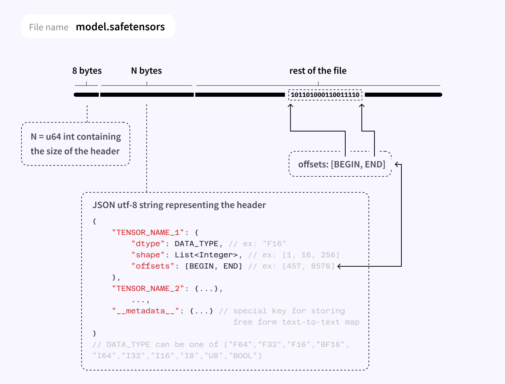

## Tinyinfer - A small inference engine for local inference of open weight models

This is just a small project to practically apply what I'm learning with CUDA.
This will not be anything close to something like vllm or llama.cpp, but is more of a learning project to:
- Understand the intricacies of different transformer architectures from first principles
- Apply parallel programming with concepts with cuda for a real use case
- Practice optimisation techniques for faster inference on my RTX 5070 Ti

For this project I will be attempting to get inference working on the [TinyLlama 1.1b model](https://github.com/jzhang38/tinyllama)
No quanitization (yet), for now focusing on FP16 suporting the SafeTensors format

## How to build

Run `cmake --build build`

The binary will then be executable from `./build/tinyinfer`

## Safetensor format spec



Source: https://huggingface.co/docs/safetensors/en/index

## Dependencies

To build the project, you need:

- CMake 3.25 or newer
- A C++20 compiler
- The NVIDIA CUDA Toolkit with a C++20-capable CUDA compiler (`nvcc`)
- An NVIDIA GPU and compatible driver to run the CUDA code

CMake downloads and builds these libraries during configuration, so you do not need to install them separately:

- [nlohmann/json](https://github.com/nlohmann/json) 3.12.0 for parsing SafeTensors JSON headers
- [SentencePiece](https://github.com/google/sentencepiece) 0.2.1 for tokenisation

## Tokenising input and looking up embeddings

For the TinyLlama 1.1B model used in this project, the SentencePiece tokenizer uses BPE to split input text into tokens using the `tokenizer.model` file that comes with the model. It then assigns each token an ID from the model's vocabulary. This turns a sentence into a sequence of IDs that the model can process.

In this model, the embedding weights are stored in `model.embed_tokens.weight dtype=BF16`. They contain 32,000 vectors of 2,048 BF16 values each `shape=[32000,2048] offsets=[131072000,262144000]`. Each token ID identifies one of those embedding vectors, so looking up the IDs in the embedding weights turns the input into a sequence of vectors. These embedding vectors are then passed into the transformer layers, where they are used to compute the query, key, and value (QKV) representations required for self-attention.

## TinyLLama 1.1b - Architecture

- Constists of language modeeling head which is the final output layer of the LLM `lm_head.weight dtype=BF16 shape=[32000,2048] offsets=[0,131072000]`
- The model's embedding map/token embedding matrix,  model.embed_tokens.weight dtype=BF16 shape=[32000,2048] offsets=[131072000,262144000]
- Then we have 22 Transformer blocks - labelled from 0 to 21
- One transformer block consists of just a decoder layer made up of 3 components: RMSNorm, Grouped-Query Attention, and a Feed-Forward network 
- Here is the first layer (Note: the order presented is not the actual order of operations within the transformer):
```
model.layers.0.input_layernorm.weight dtype=BF16 shape=[2048] offsets=[262144000,262148096]
model.layers.0.mlp.down_proj.weight dtype=BF16 shape=[2048,5632] offsets=[262148096,285216768]
model.layers.0.mlp.gate_proj.weight dtype=BF16 shape=[5632,2048] offsets=[285216768,308285440]
model.layers.0.mlp.up_proj.weight dtype=BF16 shape=[5632,2048] offsets=[308285440,331354112]
model.layers.0.post_attention_layernorm.weight dtype=BF16 shape=[2048] offsets=[331354112,331358208]
model.layers.0.self_attn.k_proj.weight dtype=BF16 shape=[256,2048] offsets=[331358208,332406784]
model.layers.0.self_attn.o_proj.weight dtype=BF16 shape=[2048,2048] offsets=[332406784,340795392]
model.layers.0.self_attn.q_proj.weight dtype=BF16 shape=[2048,2048] offsets=[340795392,349184000]
model.layers.0.self_attn.v_proj.weight dtype=BF16 shape=[256,2048] offsets=[349184000,350232576]
```
- High level overview of decoder: The input to the decoder layer -> (RMSNorm) uses  input_layernorm weights -> (GQA) uses self_attn.* weights -> (RMSNorm) post_attention_layernorm weights -> (FFN) mlp.* weights -> output of layer
- Reference of Llama Transformer Architecture: https://github.com/huggingface/transformers/blob/v4.35.0/src/transformers/models/llama/modeling_llama.py
