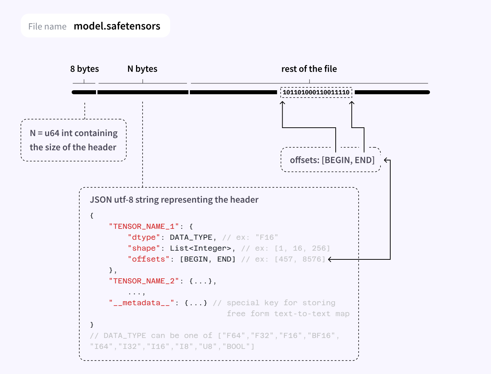

## Tinyinfer - A small inference engine for local inference of open weight models

This is just a small project to practically apply what I'm learning with CUDA.
This will not be anything close to something like vllm or llama.cpp, but is more of a learning project to:
- Understand the intricacies of different transformer architectures from first principles
- Apply parallel programming with concepts with cuda for a real use case
- Practice optimisation techniques for faster inference on my RTX 5070 Ti

For this project I will be attempting to get inference working on the [TinyLlama 1.1b model](https://github.com/jzhang38/tinyllama)
No quanitization (yet), for now focusing on FP16 suporting the SafeTensors format

## Safetensor format spec

Source: https://huggingface.co/docs/safetensors/en/index

## Dependencies

To build the project, you need:

- CMake 3.25 or newer
- A C++20 compiler
- The NVIDIA CUDA Toolkit with a C++20-capable CUDA compiler (`nvcc`)
- An NVIDIA GPU and compatible driver to run the CUDA code

CMake downloads and builds these libraries during configuration, so you do not need to install them separately:

- [nlohmann/json](https://github.com/nlohmann/json) 3.12.0 for parsing SafeTensors JSON headers
- [SentencePiece](https://github.com/google/sentencepiece) 0.2.1 for tokenisation

## Tokenising input and looking up embeddings

For the TinyLlama 1.1B model used in this project, the SentencePiece tokenizer uses BPE to split input text into tokens using the `tokenizer.model` file that comes with the model. It then assigns each token an ID from the model's vocabulary. This turns a sentence into a sequence of IDs that the model can process.

In this model, the embedding weights are stored in `model.embed_tokens.weight`. They contain 32,000 vectors of 2,048 BF16 values each. Each token ID identifies one of those embedding vectors, so looking up the IDs in the embedding weights turns the input into a sequence of vectors. These embedding vectors are then passed into the transformer layers, where they are used to compute the query, key, and value (QKV) representations required for self-attention.
